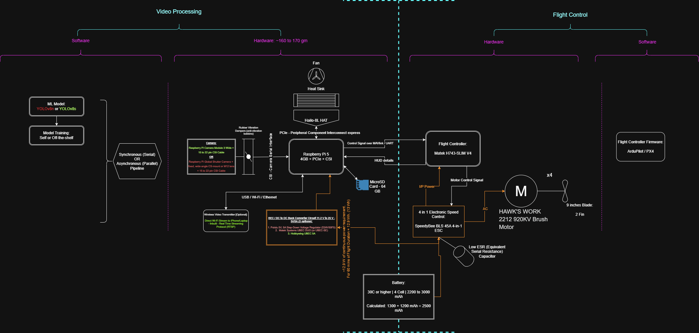

# Autonomous Vision-Guided Drone 🚁

**Status:** Phase 1 Complete (Vision Processing) | **Domain:** Embedded Systems & Edge AI | **Hardware:** Raspberry Pi 5 + Hailo-8L NPU

## Product Development Roadmap

This project follows an iterative systems engineering approach, currently transitioning from isolated AI payload testing to full vehicle integration. Because component dependencies are highly coupled, the hardware architecture is finalized through closed-loop iterations optimizing for our primary metric: **total active flight time**.

* **Phase 1: Vision Payload & Edge AI (Completed)**
  Integration of the Raspberry Pi 5 and Hailo-8L. Developed the C++ vision pipeline, implemented zero-compute centroidal masking, and validated real-time tracking via desk testing.
* **Phase 2: Peripheral Architecture & CAD Prototyping (In Progress)**
  Establishing the ballpark component baseline (Flight Controller, ESCs, Motors, Battery, Propellers) and developing the initial custom frame CAD.
* **Phase 3: Iterative Systems Optimization**
  Executing iterative hardware loops. Re-evaluating the frame design and peripheral configurations against payload weight to lock in a solid system architecture with a positive flight time yield.
* **Phase 4: Flight Control Integration & Active Testing**
  Interfacing the vision payload coordinates with the flight controller to achieve autonomous, real-world dynamic target tracking.

## System Architecture
The payload is built around a first-principles approach to hardware acceleration, ensuring real-time inference without bottlenecking downstream flight control systems. 

* **Compute Unit:** Raspberry Pi 5
* **AI Accelerator:** Hailo-8L NPU (Neural Processing Unit)
* **Vision Sensor:** IMX708 Wide Camera Module
* **Streaming Protocol:** MediaMTX for low-latency RTSP video streaming



## Software Stack & Pipeline

The core architecture is written in **C++** to maintain strict control over hardware interfaces, memory buffers, and execution speed, directly linking mathematical tracking abstractions to hardware execution.

1. **Vision Capture:** Raw frames are ingested from the IMX708 sensor.
2. **Inference Pipeline (HailoRT):** Frames are passed directly to the Hailo-8L NPU using the C++ HailoRT API, bypassing the CPU to run YOLOv8s object detection and person tracking.
3. **Spatial Processing:** Implementation of centroidal masking to extract accurate target coordinates for tracking.
4. **Telemetry & Streaming:** Annotated video output is broadcast via MediaMTX over RTSP for real-time ground-station monitoring.

## Current State: Phase 1 Desk Test

Phase 1 focused on validating the C++ vision pipeline, NPU acceleration, and thermal stability in a controlled environment prior to active flight integration. 

**Results:**
* Successfully compiled and deployed the YOLOv8s pipeline to the Hailo-8L.
* Achieved stable, real-time object tracking and centroidal masking.
* Verified RTSP stream latency bounds over MediaMTX.


## Next Steps: Hardware Prototyping & Flight Integration

* **Peripheral Architecture:** Finalizing the baseline component selection (Flight Controller, ESCs, Motors, Battery) to safely support the active power draw of the Pi 5 and Hailo-8L payload.
* **Custom CAD & Vibration Isolation:** Designing the structural drone frame to house the compute stack and IMX708 sensor, specifically incorporating dampening to protect against motor resonance and hardware shear.
* **Iterative Flight Time Optimization:** Executing hardware iteration loops to balance the thrust-to-weight ratio against the heavy AI payload, aiming to maximize total active flight time.
* **Flight Controller Interfacing:** Mapping the validated centroidal coordinate data from the C++ vision pipeline into velocity commands for autonomous dynamic target tracking.

## Repository Structure

```text
├── docs/
│   ├── BOM/
│   │   ├── BOM_C001_Rev.A_20_Sep_2026.xlsx             # Hardware bill of materials (Initial)
│   │   └── BOM_VP_20_Sep_2026_For_AI_Audit.pdf         # AI payload component audit
│   ├── Learnings/
│   │   └── Multi Rate Control Systems Analysis.html    # Control systems & architecture notes
│   ├── Machine Vision Requirements.pdf                 # Core vision system specifications
│   ├── Power_consumption_flight_time_analysis.html     # Hardware iteration metrics
│   ├── Requirement_Tracability_Matrix.html             # Systems engineering tracking
│   └── TDP_System_Architechture_C001_Rev.B.png         # Hardware/Software architecture diagram
├── include/
│   └── HailoYOLOv8.hpp                                 # C++ header for NPU integration
├── prototype/
│   └── drone_hud.py                                    # Initial Python prototyping & HUD
├── src/
│   ├── HailoYOLOv8.cpp                                 # HailoRT NPU pipeline & centroid logic
│   └── main.cpp                                        # Core C++ application entry point
├── CMakeLists.txt                                      # CMake build configuration for edge deployment
└── README.md
